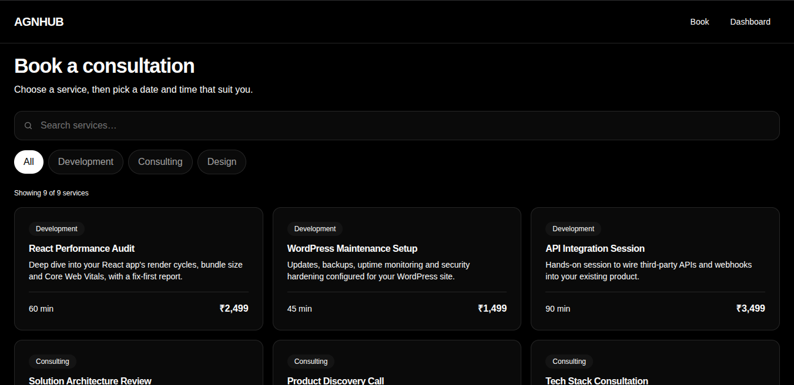
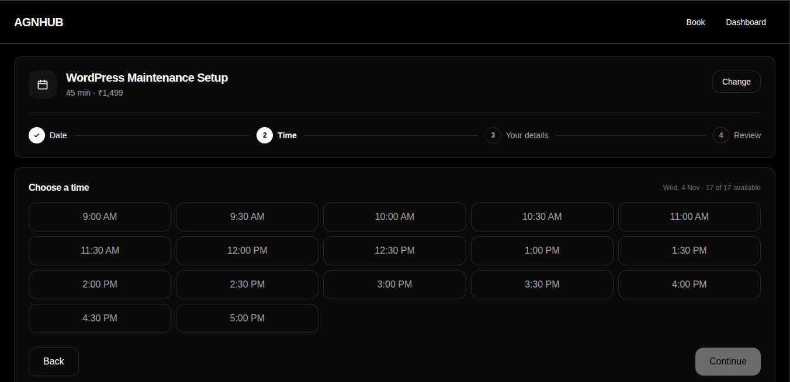
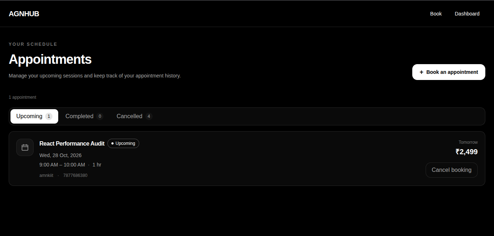
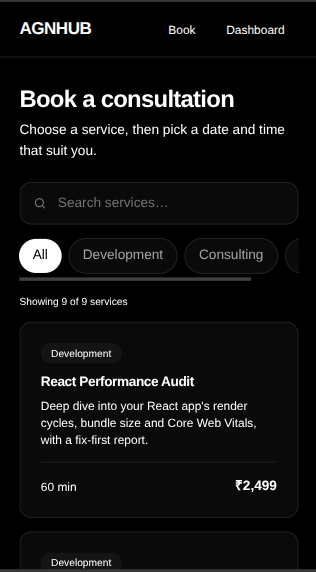

# Client Appointment & Booking Dashboard

A responsive appointment booking application built with React and TypeScript. Users can explore services, book appointments, and manage their bookings through a clean, modern interface.

## Features

- **Service Listing:** Browse services with descriptions, durations, and prices.
- **Search & Filters:** Search services and filter them by category.
- **Appointment Booking:** Select a date and available time slot, enter customer details, and review the booking before confirmation.
- **Duplicate Booking Prevention:** Prevent overlapping appointments from being booked for the same date and time.
- **Booking Dashboard:** View upcoming, completed, and cancelled appointments.
- **Cancellation:** Cancel upcoming appointments.
- **Form Validation:** Validate customer details and display relevant error messages.
- **Persistent Storage:** Save bookings in browser local storage so they remain available after refreshing the page.
- **Responsive UI:** Support desktop, tablet, and mobile screen sizes.

## Tech Stack

- React
- TypeScript
- React Router
- Tailwind CSS
- Vite
- Browser Local Storage

## Prerequisites

Make sure you have the following installed:

- [Node.js](https://nodejs.org/) (LTS version recommended)
- npm (included with Node.js)
- Git (optional, if cloning the repository)

## Run Locally

## Run Locally

### 1. Clone the repository

```bash
git clone https://github.com/ankitbareth-dev/assessment-agn-hub.git
```

### 2. Navigate to the project directory

```bash
cd assessment-agn-hub
```

### 3. Install dependencies

```bash
npm install
```

### 4. Start the development server

```bash
npm run dev
```

### 5. Open the application

Open the local URL displayed in your terminal, usually http://localhost:5173.

```text
http://localhost:5173
```

## Implementation Overview

1. Built the application with React and TypeScript for reusable components and type-safe data handling.
2. Used React Router to navigate between service listings, booking flows, and the appointment dashboard.
3. Organized service information and booking utilities into separate modules to keep the code maintainable.
4. Implemented a multi-step booking flow with date and time selection, customer details, review, and confirmation.
5. Prevented duplicate and overlapping bookings by checking existing appointments before saving a new booking.
6. Used browser local storage to persist bookings and support appointment cancellation without requiring a backend.
7. Applied Tailwind CSS and a consistent monochrome design system to create a polished, responsive interface.

## Screenshots

### Service Listing



### Appointment Booking



### Booking Dashboard



### Mobile Responsive Layout



## Live Demo

Live demo link will be added here.

## Notes

This assessment project uses local sample data and browser local storage. Bookings are stored in the current browser and are not shared across different browsers or devices. No backend or database is required.
